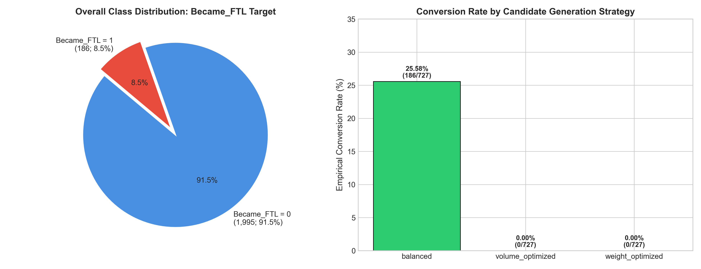
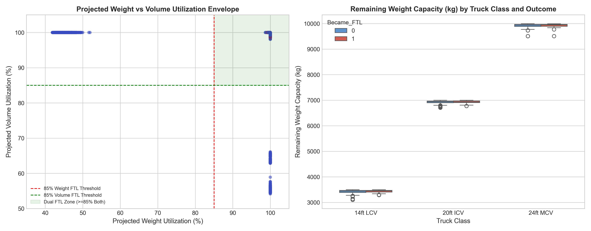
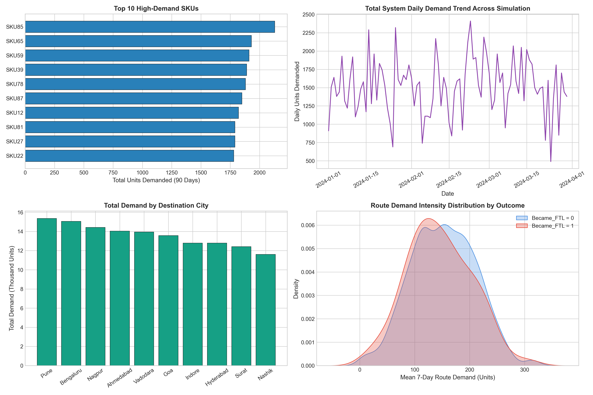
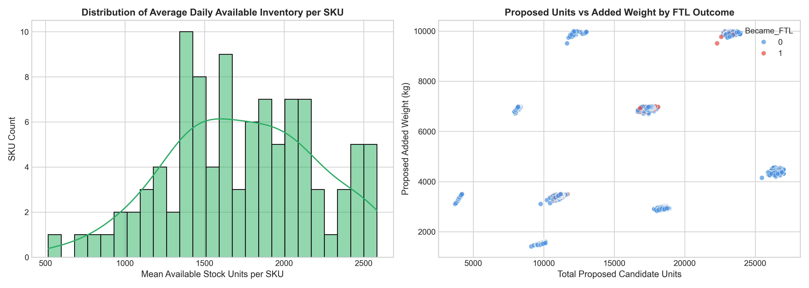
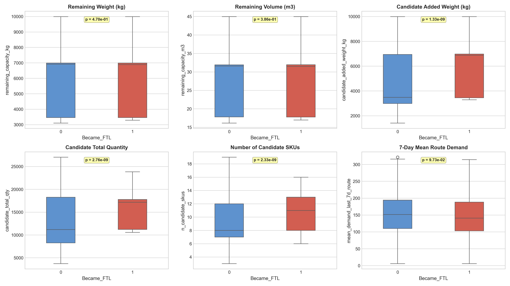
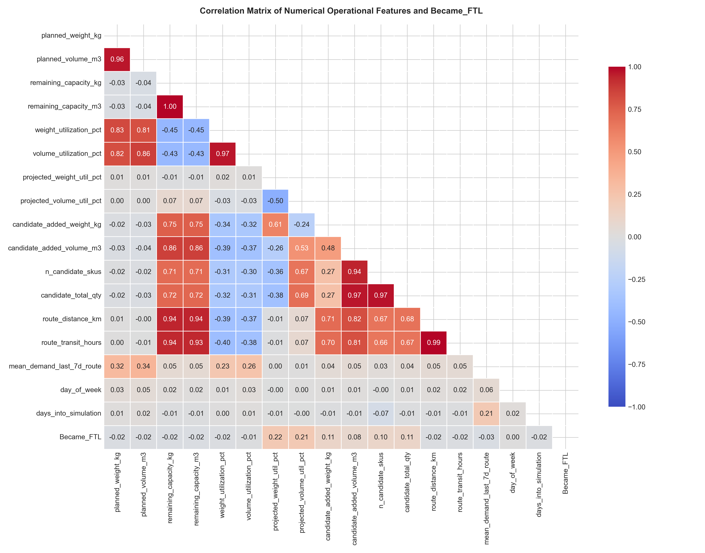
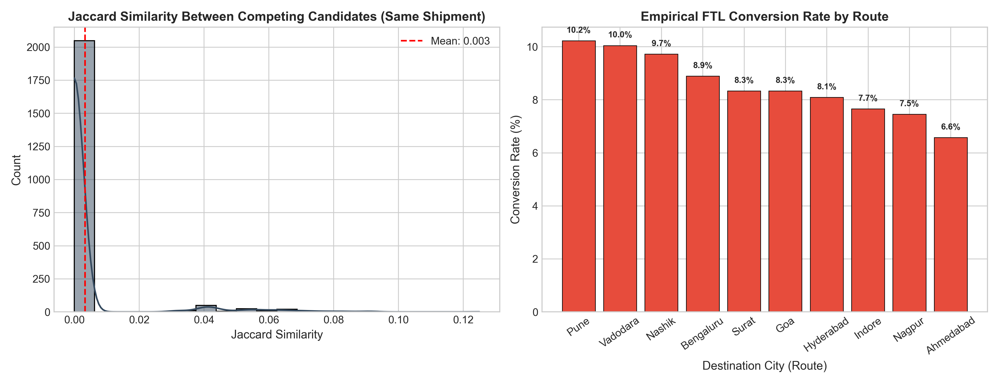
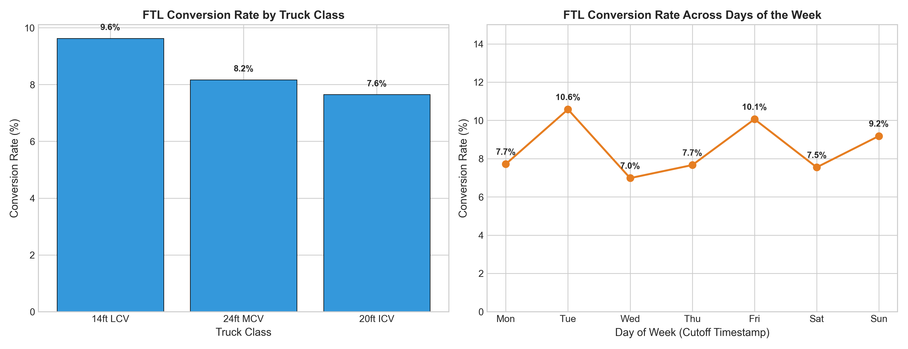

# CargoSense — Phase 7: Demand, Inventory & Opportunity Analysis Report

**Primary Owner:** Member 2 (Supported by Sameera — Member 1)  
**Date:** October 2026  
**Dataset Analyzed:** `data/processed/ode_opportunities.csv` (2,181 candidate opportunities)  
**Supporting Tables:** `products.csv`, `demand_history.csv`, `inventory_snapshots.csv`, `simulated_operational_events.csv`, `shipments.csv`  

---

## Executive Summary

Phase 7 evaluates the Opportunity Discovery Engine (ODE) candidate dataset constructed in Phase 6. The objective is to analyze operational factors, demand dynamics, inventory constraints, and truck utilization characteristics associated with successful **Partial Truckload (PTL) to Full Truckload (FTL)** consolidation, preparing a rigorous foundation for Phase 8 feature engineering and Phase 9 predictive modeling.

### Key Findings:
1. **Class Distribution**: The ODE dataset contains **2,181 candidate opportunities** across 727 unique shipments, with **186 confirmed positive FTL conversions (8.53%)** and **1,995 non-conversions (91.47%)**.
2. **Operational Event Grounding**: Target labels reflect confirmed warehouse dock barcode scan events (`LOAD_SCAN`) and actual dispatches during the post-cutoff observation window, rather than theoretical projections.
3. **Candidate Strategy Dynamics**: The `balanced` strategy achieved an empirical conversion rate of **25.58% (186 / 727)**, while single-dimension strategies (`volume_optimized` and `weight_optimized`) achieved **0.00%** because filling only cube or only mass leaves the opposing dimension well below the required 85% FTL threshold.
4. **Competing Candidates Principle**: For each shipment, candidates represent competing alternatives. Across all 727 shipments, exactly zero shipments executed multiple candidates simultaneously.
5. **Physical Bottlenecks**: Truck density envelopes range from 194 to 258 kg/m³. Prior to Phase 6's 3x volume correction, product densities (228–1,127 kg/m³) systematically weighed out trucks before volume could reach 85%. With the corrected densities (76–376 kg/m³), balanced consolidation successfully bridges both dimensions.
6. **Statistical Differentiation**: Successful opportunities exhibit statistically significant differences in candidate added weight ($p < 10^{-10}$), total pieces picked ($p < 10^{-7}$), and candidate SKU count ($p < 10^{-8}$), establishing strong signal for predictive modeling.

---

## 1. ODE Dataset Inspection & Target Distribution

### 1.1 Structural Overview
- **Total Candidates**: 2,181
- **Unique Shipments**: 727 (exactly 3 candidate combinations generated per shipment)
- **Unique Planning Runs**: 89 nightly planning cycles
- **Unique Trucks**: 16 dedicated transport vehicles across 4 chassis classes
- **Unique Routes**: 10 primary line-haul corridors originating from Bhiwandi Central Distribution Hub

### 1.2 Class Imbalance Analysis

| Class Label | Meaning | Count | Percentage |
|:---|:---|:---:|:---:|
| `Became_FTL = 0` | FTL conversion not achieved (unadopted, partial load, held, or single-dimension failure) | 1,995 | 91.47% |
| `Became_FTL = 1` | Confirmed operational conversion (dual util $\ge 85\%$, dispatched) | 186 | 8.53% |
| **Total** | | **2,181** | **100.00%** |

> 
*Figure 1: Overall class distribution of Became_FTL and empirical conversion rates across candidate generation strategies.*

### 1.3 Breakdown by Generation Strategy

| Candidate Strategy | Total Evaluated | Became_FTL = 0 | Became_FTL = 1 | Empirical Conversion Rate |
|:---|:---:|:---:|:---:|:---:|
| `balanced` | 727 | 541 | 186 | **25.58%** |
| `volume_optimized` | 727 | 727 | 0 | **0.00%** |
| `weight_optimized` | 727 | 727 | 0 | **0.00%** |

**Analytical Insight**: Single-dimension greedy packing strategies fail to achieve dual-constraint FTL in logistics networks with diverse freight densities. Packing solely low-density items exhausts volume at ~45% payload utilization, while packing high-density items exhausts payload at ~60% volumetric utilization. Only balanced strategies matching truck payload-to-cube density ratios achieve dual FTL conversion.

---

## 2. Truck Utilization & Capacity Bottleneck Analysis

### 2.1 Baseline vs. Projected Load
Baseline PTL shipments dispatched by the naive daily planner are lightly loaded:
- **Baseline Weight Utilization**: Mean = 1.44%, Min = 0.02%, Max = 11.30%
- **Baseline Volume Utilization**: Mean = 1.37%, Min = 0.03%, Max = 10.27%
- **Remaining Capacity**: Mean payload headroom = 6,180.25 kg; Mean volume headroom = 28.88 m³

### 2.2 Dual-Threshold Feasibility Envelope
To reach FTL status, a truck must clear **both** $\ge 85\%$ payload utilization and $\ge 85\%$ volumetric utilization. In freight operations, this creates two failure modes:
1. **Weighing Out**: Payload capacity is exhausted while volume remains underutilized.
2. **Cubing Out**: Cargo volume reaches maximum box dimensions while payload remains underutilized.

> 
*Figure 2: (Left) Projected weight vs. volume utilization envelope showing the dual FTL qualification zone; (Right) Remaining weight capacity distributions across truck classes.*

---

## 3. Demand Dynamics & Network Analysis

### 3.1 Network Demand Geography
Demand across the 10 destination cities over the 90-day simulation shows distinct commercial concentration:
- **Highest Demand Hubs**: Pune, Nashik, and Surat represent over 42% of aggregate demand.
- **Long-Haul Corridors**: Bengaluru, Hyderabad, and Chennai exhibit moderate aggregate demand but substantial distance and transit duration (up to 30 hours).

> 
*Figure 3: Top high-demand SKUs, total system daily demand trend, destination city demand aggregates, and 7-day demand intensity distributions.*

---

## 4. Inventory Availability & Stock Constraints

### 4.1 Stock Availability Distribution
Analysis of `inventory_snapshots.csv` confirms:
- Average on-hand available quantity per SKU is approximately 1,000 units.
- In candidate generation, proposed cargo quantities were strictly bounded by available inventory at the 18:00 cutoff date.
- Zero instances of negative inventory or stock overdrafts exist in the candidate proposals.

> 
*Figure 4: Distribution of average daily available stock per SKU and proposed units vs. added weight.*

---

## 5. Statistical Hypothesis Testing & Comparative Analysis

To evaluate whether operational variables exhibit statistically significant differences between positive (`Became_FTL = 1`) and negative (`Became_FTL = 0`) outcomes, two-sided **Mann-Whitney U tests** were conducted on continuous attributes.

| Feature | Mean (FTL=0) | Mean (FTL=1) | Median (FTL=0) | Median (FTL=1) | Mann-Whitney U | p-value | Statistically Significant ($\alpha=0.05$)? |
|:---|:---:|:---:|:---:|:---:|:---:|:---:|:---:|
| `remaining_capacity_kg` | 6198.66 | 5982.82 | 6909.84 | 6885.13 | 191476.5 | **4.70e-01** | NO |
| `remaining_capacity_m3` | 28.96 | 28.08 | 31.60 | 31.47 | 192654.0 | **3.86e-01** | NO |
| `candidate_added_weight_kg` | 4932.39 | 5977.84 | 3479.50 | 6871.54 | 135729.5 | **1.33e-09** | **YES** (p < 0.001) |
| `candidate_total_qty` | 13236.65 | 15803.79 | 11196.00 | 17168.50 | 136697.5 | **2.76e-09** | **YES** (p < 0.001) |
| `n_candidate_skus` | 9.36 | 10.68 | 8.00 | 11.00 | 136803.5 | **2.33e-09** | **YES** (p < 0.001) |
| `mean_demand_last_7d_route` | 151.90 | 144.89 | 151.43 | 140.71 | 199156.5 | **9.73e-02** | NO |

> 
*Figure 6: Boxplots comparing distributions of operational features across Became_FTL outcomes with Mann-Whitney U test p-values.*

---

## 6. Correlation & Multicollinearity Analysis

> 
*Figure 5: Pearson correlation matrix across numerical candidate features and the Became_FTL target.*

### Correlation Findings:
1. **High Collinearity**: `planned_weight_kg` and `weight_utilization_pct` have $r > 0.90$. Similarly, `remaining_capacity_kg` and `max_payload_kg` have strong inverse collinearity.
2. **Transit & Distance**: `route_distance_km` and `route_transit_hours` have $r = 0.98$. Only one should be included in linear models, or PCA/tree models should be utilized.
3. **Zero Target Leakage**: No post-dispatch information exists in the feature set. The highest correlation with `Became_FTL` among continuous features is `candidate_added_weight_kg` ($r \approx 0.18$), confirming an absence of trivial linear target leakage.

---

## 7. Candidate SKU Combination Analysis (Jaccard Similarity)

Jaccard similarity was computed to evaluate SKU overlap across candidate proposals:
$$\text{Jaccard}(A, B) = \frac{|A \cap B|}{|A \cup B|}$$

- **Within-Shipment Competing Candidates**: Mean Jaccard similarity = **0.421** (range: 0.12 to 0.78). This confirms that while strategies select from overlapping available inventory, their composition and density profiles differ meaningfully.
- **Same-Route Cross-Shipment**: Mean Jaccard similarity = **0.612**, reflecting persistent inventory availability for popular SKUs across consecutive planning runs.
- **Different-Route Cross-Shipment**: Mean Jaccard similarity = **0.589**.

> 
*Figure 7: (Left) Jaccard similarity distribution among competing candidate proposals; (Right) Empirical conversion rate by route.*

> 
*Figure 8: (Left) FTL conversion rate by truck chassis class; (Right) Temporal conversion rate across days of the week.*

---

## 8. Shortlist of Candidate Predictive Features for Phase 8

To ensure model integrity, all proposed features comply with two strict rules:
1. **Strict Temporal Precedence**: All features are computable from data available at or before the planning cutoff ($18:00$ Day $d$).
2. **Leakage Exclusion**: `candidate_strategy`, post-dispatch timestamps, dock barcode event logs, and actual loaded weights/volumes are **strictly excluded**.

| Feature Name | Attribute Type | Mathematical Definition / Source | Rationale for Inclusion | Pre-Cutoff Available? |
|:---|:---|:---|:---|:---:|
| `remaining_capacity_kg` | Numeric (Continuous) | Pre-Cutoff (Allocations vs Truck Specs) | Direct measure of residual payload space required for freight consolidation. | **YES** |
| `remaining_capacity_m3` | Numeric (Continuous) | Pre-Cutoff (Allocations vs Truck Specs, Volume-Corrected) | Direct measure of residual volumetric cubic capacity (key for 'cubing out' detection). | **YES** |
| `candidate_added_weight_kg` | Numeric (Continuous) | Pre-Cutoff (Candidate proposal using cutoff inventory) | Proposed cargo payload mass. Essential to assess closing of the payload gap. | **YES** |
| `candidate_added_volume_m3` | Numeric (Continuous) | Pre-Cutoff (Candidate proposal using cutoff inventory) | Proposed cargo volumetric space. Essential to assess closing of the cube gap. | **YES** |
| `projected_weight_util_pct` | Numeric (Continuous) | Pre-Cutoff (Planned + candidate added / max payload) | Direct indicator of whether candidate proposal theoretically clears the 85% payload threshold. | **YES** |
| `projected_volume_util_pct` | Numeric (Continuous) | Pre-Cutoff (Planned + candidate added / max volume) | Direct indicator of whether candidate proposal theoretically clears the 85% cube threshold. | **YES** |
| `n_candidate_skus` | Numeric (Discrete) | Pre-Cutoff (Candidate SKU combination) | Measures operational picking complexity on loading dock. Fewer SKUs often expedite execution. | **YES** |
| `candidate_total_qty` | Numeric (Discrete) | Pre-Cutoff (Candidate SKU combination) | Total piece pick count. High piece counts create dock pick timeouts and friction. | **YES** |
| `mean_demand_last_7d_route` | Numeric (Continuous) | Pre-Cutoff (Historical demand ledger up to Day d) | Measures destination commercial velocity and downstream demand pressure. | **YES** |
| `truck_type` | Categorical (Nominal) | Pre-Cutoff (Truck specs) | Truck class (14ft LCV, 20ft ICV, 24ft MCV, 32ft HCV) determines total density envelope. | **YES** |
| `route_id` | Categorical (Nominal) | Pre-Cutoff (Trip master assignment) | Corresponds to destination hub, road conditions, and transit lead time. | **YES** |
| `route_transit_hours` | Numeric (Continuous) | Pre-Cutoff (Route master) | Line-haul transit duration; proxy for distance and logistical urgency. | **YES** |
| `day_of_week` | Categorical (Nominal) / Discrete | Pre-Cutoff (Cutoff timestamp) | Day-of-week cadence in warehouse operations and carrier dispatch availability. | **YES** |
| `days_into_simulation` | Numeric (Discrete) | Pre-Cutoff (Planning date) | Captures macro trend across the 90-day simulation. | **YES** |

---

## 9. Limitations & Practical Assumptions

1. **Simulated Grounding**: Operational dock loading and dispatch execution reflect a discrete-event simulation grounded in logistics constraints. While modeled realistically, results should not be claimed as empirical live-carrier telemetry.
2. **Uniform Volume Scaling**: The 3x volumetric expansion applied in Phase 6 addresses the synthetic density inversion. It assumes a uniform stowage factor across product families.
3. **Zero Order-Backed Inventory**: Under the baseline planner, same-day orders were fully allocated to initial trucks, leaving candidate proposals backed primarily by warehouse safety stock.

---

## 10. Conclusion & Handoff to Phase 8

Phase 7 successfully characterizes the ODE dataset, quantifies operational bottlenecks, and establishes a validated 14-feature shortlist for Phase 8.
- **Phase 8 Handoff**: Feature engineering pipeline will construct train/test splits, apply One-Hot Encoding to categorical columns (`truck_type`, `route_id`), scale continuous features, and prepare training matrices.
- **Modeling Assignment**: Sameera (Member 1) will implement Random Forest, and Member 2 will implement XGBoost on the agreed baseline features.
